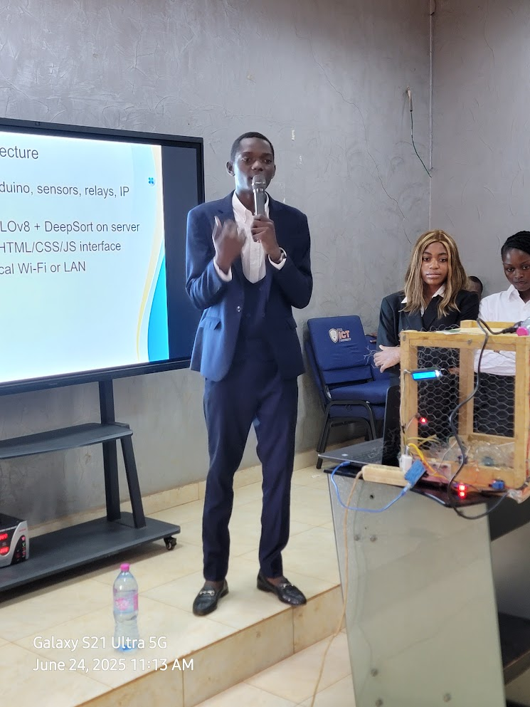
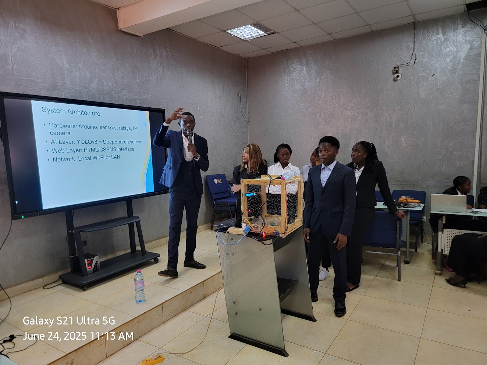
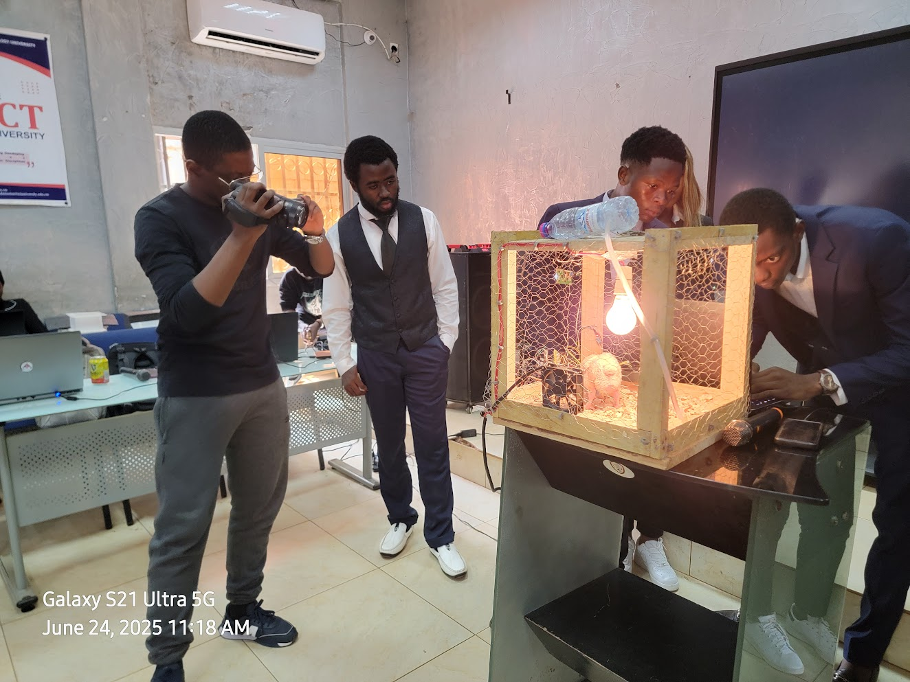

# SmartPoultry

SmartPoultry a pour objectif de réduire au minimum la présence humaine dans
la conduite quotidienne d'un élevage de volailles. Le système collecte les
données de l'environnement, les transmet à une intelligence artificielle
locale exécutée avec Ollama, puis adapte automatiquement les conditions
d'élevage selon des règles contrôlées.

Le projet regroupe un programme Arduino pour la collecte des mesures et le
pilotage des équipements, ainsi qu'une base de projet Django destinée à
accueillir l'interface web et le suivi de l'élevage.

## Vision du projet

SmartPoultry doit devenir un système d'élevage connecté capable de :

- surveiller en continu la température, l'humidité, l'eau et l'ambiance du
  poulailler ;
- analyser les données historiques et les événements inhabituels avec une IA
  locale connectée à Ollama ;
- piloter la ventilation, l'éclairage, l'abreuvement et les mécanismes
  d'alimentation sans intervention permanente ;
- analyser les fientes à partir d'images ou de prélèvements afin de détecter
  des signes compatibles avec une maladie ;
- signaler le niveau de confiance, les observations et les actions
  recommandées ;
- préparer une solution de traitement de l'eau avec un dosage mesuré,
  traçable et validé par un vétérinaire.

L'IA ne doit pas remplacer le diagnostic vétérinaire. Une détection est une
alerte ou une recommandation, pas une certitude médicale.

## Architecture cible

```text
Capteurs et caméra
        │
        ▼
Arduino ──(mesures et commandes)──► Service Django
                                      │
                                      ├── Historique et tableau de bord
                                      ├── Moteur de règles de sécurité
                                      └── Ollama (analyse locale)
                                             │
                                             ▼
                              Alertes et commandes proposées
                                      │
                                      ▼
                         Validation / autorisation vétérinaire
                                      │
                                      ▼
                          Pompe doseuse et équipements
```

Le modèle Ollama pourra interpréter les mesures, les tendances et les
observations visuelles, mais les commandes physiques devront passer par un
moteur de règles indépendant. Celui-ci doit empêcher une action dangereuse
(dose excessive, absence d'eau, température critique ou capteur défaillant).

## Aperçu

<p align="center">
  
  
  
</p>

## Fonctionnalités actuelles

Le firmware [`iot.ino`](iot.ino) :

- mesure la température et l'humidité avec un DHT11 ;
- mesure le niveau d'eau avec une entrée analogique ;
- mesure une distance avec un capteur ultrason ;
- affiche les mesures sur un écran LCD I2C 16x2 ;
- envoie les mesures dans le moniteur série à 9 600 bauds ;
- commande un servo-moteur ;
- commande un relais pour la lampe et un relais pour le ventilateur.

Le dossier [`Smartpoultry/`](Smartpoultry/) contient un projet Django 5.2
initialisé avec SQLite, l'administration Django et les fichiers ASGI/WSGI.
La communication avec Arduino, l'interface web, l'analyse IA et le dosage
automatique restent à implémenter.

## Structure du projet

```text
Smartpoultry/
├── 1.jpg                         # Photo de l'installation
├── 2.jpg                         # Photo de l'installation
├── 3.jpg                         # Photo de l'installation
├── iot.ino                       # Programme Arduino
├── requirement.txt               # Dépendances Python
├── README.md
└── Smartpoultry/
    ├── manage.py
    └── Smartpoultry/
        ├── settings.py
        ├── urls.py
        ├── asgi.py
        └── wsgi.py
```

## Matériel et câblage

| Élément | Broche Arduino |
| --- | --- |
| Relais ventilateur | D7 |
| Relais lampe | D8 |
| TRIG capteur ultrason | D4 |
| ECHO capteur ultrason | D5 |
| DHT11 | D6 |
| Capteur de niveau d'eau | A0 |
| Servo-moteur | D3 |
| Écran LCD I2C | Adresse `0x27` |

Les masses (`GND`) doivent être communes entre l'Arduino, les capteurs, le
LCD, le servo et les relais. Vérifiez également la tension et l'isolation des
relais avant de connecter une charge secteur.

## Installer la partie Django

Depuis la racine du dépôt :

```bash
python -m venv .venv
```

Sous Windows :

```powershell
.venv\Scripts\Activate.ps1
pip install -r requirement.txt
python Smartpoultry\manage.py migrate
python Smartpoultry\manage.py runserver
```

L'application Django est ensuite disponible à l'adresse
<http://127.0.0.1:8000/>.

## Téléverser le firmware Arduino

1. Ouvrir [`iot.ino`](iot.ino) dans l'Arduino IDE.
2. Installer les bibliothèques `DHT`, `LiquidCrystal_I2C` et `Servo`.
3. Sélectionner la carte et le port série correspondants.
4. Compiler puis téléverser le programme.
5. Ouvrir le moniteur série à **9 600 bauds** pour observer les mesures.

## Cycle de fonctionnement

À chaque cycle, le programme lit la température, l'humidité, le niveau d'eau
et la distance, puis les affiche et les transmet sur le port série. Le servo
passe ensuite de 0 à 180 degrés. Enfin, la lampe et le ventilateur sont
commandés successivement par les relais.

Les temporisations des relais sont actuellement codées directement dans le
firmware. Elles devront être ajustées avant une utilisation réelle et
remplacées idéalement par une logique basée sur des seuils de température,
d'humidité ou de niveau d'eau.

## Plan d'évolution vers l'élevage autonome

### 1. Collecte et fiabilisation

- ajouter une caméra adaptée à l'observation des animaux et des fientes ;
- associer chaque mesure à une date, un capteur et un niveau de qualité ;
- détecter les capteurs débranchés, les valeurs impossibles et les coupures ;
- ajouter un stockage durable des mesures et des événements.

### 2. Analyse avec Ollama

- installer Ollama sur le serveur local ;
- exposer un service d'analyse Django vers le modèle local ;
- fournir à l'IA les mesures récentes, les tendances et le contexte de
  l'élevage ;
- produire des sorties structurées : observation, risque, confiance,
  recommandation et urgence ;
- conserver chaque analyse pour permettre un contrôle a posteriori.

### 3. Analyse des fientes et santé animale

L'analyse devra combiner les images, les mesures d'ambiance, la consommation
d'eau et les observations de comportement. Elle pourra rechercher des signes
comme un changement de couleur, de texture ou de fréquence, sans présenter
ces signes comme un diagnostic définitif. Les cas suspects doivent déclencher
une alerte et une validation professionnelle.

### 4. Traitement de l'eau

Une pompe doseuse et un réservoir séparé pourront être ajoutés pour préparer
un traitement autorisé. Le système devra appliquer une recette validée,
calculer le volume nécessaire, contrôler la concentration, enregistrer le
lot et empêcher toute injection si les conditions de sécurité ne sont pas
réunies. Aucun médicament ou remède ne doit être choisi ou dosé
automatiquement par le modèle sans validation vétérinaire et respect de la
réglementation locale.

### 5. Automatisation contrôlée

- ajouter des seuils et des horaires configurables ;
- commander progressivement la ventilation, l'éclairage et l'abreuvement ;
- ajouter un mode manuel d'urgence ;
- prévoir une alarme locale et une notification distante ;
- tester les décisions de l'IA dans un mode simulation avant toute commande
  réelle.

## Évolutions prévues

- créer l'application Django et le tableau de bord ;
- recevoir et enregistrer les mesures Arduino ;
- afficher l'historique des températures, humidités et niveaux d'eau ;
- ajouter des seuils configurables et des alertes ;
- sécuriser la commande à distance de la lampe, du ventilateur et du servo ;
- intégrer Ollama pour l'analyse locale des données ;
- ajouter l'analyse d'images des fientes et un système d'alertes sanitaires ;
- intégrer une pompe doseuse uniquement après validation vétérinaire ;
- ajouter des tests et une documentation de déploiement.

## Sécurité

Le projet est encore en développement. Avant une mise en production :

- remplacer la clé secrète Django de développement ;
- désactiver `DEBUG` ;
- définir `ALLOWED_HOSTS` ;
- protéger les équipements électriques avec des relais et alimentations
  adaptés ;
- conserver un arrêt d'urgence et une commande manuelle ;
- ne jamais administrer automatiquement un traitement sans protocole validé
  par un vétérinaire ;
- ne jamais manipuler une installation secteur sous tension.